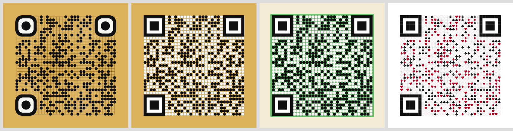
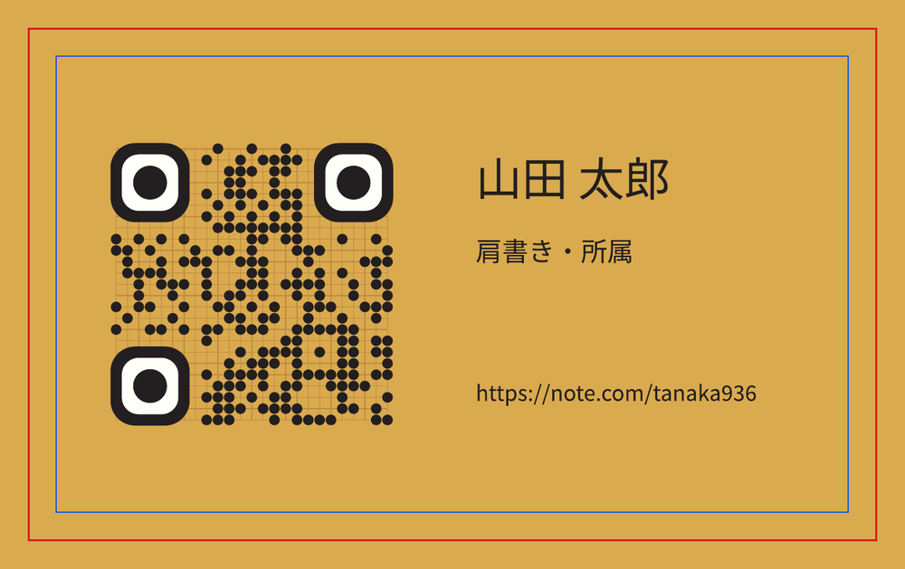
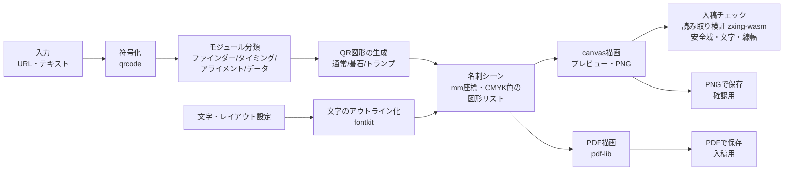

# QRcode-Converter 全体設計

最終更新: 2026-10-28（第3版：印刷会社への入稿を前提に変更）

URL（または任意テキスト）を、ドット部分を図案化したQRコードに変換し、
**名刺（91mm×55mm）として印刷会社に入稿できるデータ**を作るWebアプリ。自分用。

- 入稿用：**PDF**（CMYK・塗り足し3mm込み・文字はアウトライン化）
- 確認・手元用：**PNG**（350dpi）

ドットの図案は、通常の四角・碁石（囲碁／オセロ）・トランプのスートに対応し、ロゴも埋め込める。
名刺の縦横、QRコードの位置、文字の配置とサイズを調整できる。

---

## 1. スコープ

| 機能 | 内容 | フェーズ |
|---|---|---|
| URL変換 | URL・テキストを入力し、即時にQRを生成 | 1 |
| ドット形状：通常 | ■（暗）／□（明） | 1 |
| ドット形状：碁石 | ●（黒石）／〇（白石 or 空き） | 1 |
| 背景色選択 | プリセット（碁盤・オセロ盤・白）＋自由色。碁石＋背景色で囲碁／オセロを表現 | 1 |
| 名刺レイアウト | 91×55mm。横配置／縦配置を選択。QRの位置（寄せ）とサイズを調整 | 1 |
| 文字の配置 | 文字を複数追加し、サイズ・書体・色・位置を調整 | 1 |
| 入稿チェック | 安全域・最小文字サイズ・最小線幅・QRの読み取りを自動で確認 | 1 |
| PDF書き出し | 入稿用。97×61mm（塗り足し込み）、仕上がり枠つき、CMYK、文字はアウトライン化 | 1 |
| PNG書き出し | 確認・手元用。350dpi。仕上がりのみ／塗り足し込みを選択 | 1 |
| ドット形状：トランプ | ♣♥♦♠（暗）。明モジュールは白地のまま | 2 |
| ロゴ埋め込み | 画像をアップロードしてQRの中央に配置 | 3 |
| 仕上げ | 裏面、設定の保存と読み込み、縦書き など | 4 |

対象外（当面）：一般公開向けの機能（利用規約・OGP・アクセス解析）、短縮URLの発行、自宅印刷用の面付け。

---

## 2. 既存OSSの調査と採用方針

| OSS | ライセンス | 評価 | 採否 |
|---|---|---|---|
| [`qrcode`](https://www.npmjs.com/package/qrcode)（node-qrcode） | MIT | `QRCode.create()` でモジュール行列が取れる。UTF-8・日本語もそのまま扱える | **採用：符号化** |
| [`zxing-wasm`](https://www.npmjs.com/package/zxing-wasm) | MIT | ZXing-C++ のWASM版。ブラウザ・Node両方でQRを読める。読み取り専用ビルドは約0.9MB（gzip後約0.4MB） | **採用：読み取り検証** |
| [`pdf-lib`](https://www.npmjs.com/package/pdf-lib) | MIT | ブラウザ内でPDFを作れる。CMYKの色指定、仕上がり枠（TrimBox）・塗り足し枠（BleedBox）の設定、SVGパスの描画に対応 | **採用：PDF書き出し** |
| [`@pdf-lib/fontkit`](https://www.npmjs.com/package/@pdf-lib/fontkit) | MIT | フォントファイルを読み、文字の形（グリフの輪郭）を取り出せる。文字のアウトライン化に使う | **採用：文字** |
| Noto Sans JP／Noto Serif JP | OFL | 日本語の書体。フォントファイルを自前でホストする | **採用：文字** |
| [`@resvg/resvg-js`](https://www.npmjs.com/package/@resvg/resvg-js) | MPL-2.0 | SVG→PNGのラスタライズ。開発時のテスト専用（配布物には含めない） | **採用：テストのみ** |
| [`qr-code-styling`](https://www.npmjs.com/package/qr-code-styling) | MIT | ドット形状は固定プリセット（rounded／dots／classy 等）のみ。任意形状は描けない | 不採用（角の形・ロゴ処理の参考にする） |
| [`qrcode-generator`](https://www.npmjs.com/package/qrcode-generator) | MIT | `isDark()` で行列が取れるが、UTF-8は自前で変換が必要 | 不採用（`qrcode` で足りる） |
| [qrbtf](https://github.com/ciaochaos/qrbtf) | GPL-3.0 | パラメトリックなQR装飾の先行例 | **コードは流用しない**（GPLが本体に波及するため）。見た目の参考のみ |

**結論**：符号化・読み取り・PDF生成は既存OSSに任せ、描画（ドット形状・背景・ロゴ・名刺の配置）は自前で書く。
トランプのスートのような任意形状は既存ライブラリの範囲外で、レンダラーを統一した方が保守が楽になるため。

本リポジトリのライセンスは MIT を想定（上記の依存ライブラリと整合する）。

---

## 3. 印刷会社の入稿条件

名刺の入稿条件を、ラクスルの公式ガイドと、別の印刷サービスのガイドで確認した（2026-10-28）。

| 項目 | 条件 | 出典 |
|---|---|---|
| 推奨形式 | **PDF**（ほかに Illustrator／Photoshop／PowerPoint／Word）。**PNG・JPEGは受付形式に挙がっていない** | ラクスル |
| 塗り足し | 仕上がり位置の外側に3mm | ラクスル |
| 安全域 | 切れては困る文字・図柄は、仕上がり位置から3mm以上内側 | ラクスル |
| 断裁のずれ | 最大1mm程度ずれることがある | 別サービス |
| 画像の解像度 | 原寸で350〜400ppi | ラクスル |
| 文字サイズ | 6pt以上 | ラクスル |
| 線の太さ | 0.3pt（0.1mm）以上 | ラクスル |
| 黒 | 黒1色（K100%）で作る。混色の黒は網点になって読みにくくなることがある | 別サービス |
| カラーモード | 印刷はCMYK。RGBのデータは変換されて色が変わる | 別サービス |
| 角丸 | 角丸は印刷後の加工。データは四角で作る | ラクスル |

出典：[ラクスル 名刺の印刷用データ作成方法](https://raksul.com/guide/create-data/item/businesscard/guide/)、[TSUTAFU デザイン編集上の注意点](https://docs.channel.io/tsutafu_guide/ja/articles/4f821550)

### このアプリでの対応

- **入稿はPDF**で行う。PNGは確認・手元用とする。
- PDFは97×61mm（塗り足し込み）で作り、仕上がり枠（TrimBox）と塗り足し枠（BleedBox）を設定する。
- 背景は塗り足しの端まで塗る。
- 色は**CMYKで直接指定**する。黒（碁石・文字・ファインダー）は**K100%**。
- **文字はアウトライン化**（図形に変換）する。フォントの埋め込み不備で入稿が止まることを避けるため。
- 文字・QRは仕上がりから**3mm以上内側を必須、4mm以上を推奨**とする（断裁のずれ1mmを見込む）。
- 6pt未満の文字、0.1mm未満の線は作れないようにする。

---

## 4. 実現性検証（2026-10-28 実施）

### 4.1 図案ごとの読み取り

Node上で「描画 → PNG化 → zxing-wasmでデコード」を自動で回し、見た目ごとに読めるかを確かめた。
PNG幅 600px／250px／200px＋ぼかし の3条件。



左から：囲碁（黒石のみ・角丸の角）、囲碁（白石あり・四角の角）、オセロ（明るい緑）、トランプ（初期案の白抜きスートあり。採用版は白地）

1. **三隅の位置検出パターン（ファインダー）を碁石やスートで描くと、全条件で読めなくなった。**
   ファインダーは常に「つながった形」で描く必要がある。四角・角丸・同心円の3種で試し、四角と角丸は安定、同心円はやや弱い。
2. **囲碁（木目色の背景）は非常に安定。** 黒石だけ置いて明モジュールを空き（盤の線だけ）にしても読めた。いちばん「碁盤らしい」見た目が使える。
3. **オセロは緑の明るさ次第。**
   - 濃い緑（#2E7D32）は、外枠を明るくしないと読めない。外枠があっても、誤り訂正Hでは縮小時に不安定。
   - 明るい緑（#66BB6A）なら、四角のファインダーで全条件OK。
   - → 背景色は自由に選べるようにしつつ、**明るさのガードと実デコード検証**を必須にする。
4. **トランプ（明モジュール白地）は、短いURL（26文字）・長いURL（94文字）× 誤り訂正M/Q/H の全条件OK**（ファインダーは四角）。赤（#B00020）も暗モジュールとして読まれた。
5. **ロゴ**：中央を幅の34%（面積の約11%）まで空けても、Q・Hとも読めた。安全側に、上限を幅30%、既定を22%とする。

### 4.2 入稿用PDF

pdf-lib で、塗り足し込み97×61mm・CMYK・K100の碁石・アウトライン化した文字の名刺PDFを作り、
100〜400dpiの9段階で画像化してQRを読み取った。



赤線が仕上がり線（ここで断裁）、青線が安全域（仕上がりから3mm内側）。名前・URLは見本。

1. **PDFの寸法と枠は正しく設定できた。** ページ274.96×172.91pt（＝97×61mm）、仕上がり枠は四辺3mm内側。
2. **日本語フォントをPDFに埋め込むと、PDFビューアで「埋め込みフォントが不正」の警告が出た**（pdf-lib のCFF形式フォントのサブセット化の不具合）。
   **文字を図形に変換（アウトライン化）すると問題なく、ファイルも20KBと軽い。** → 文字は常にアウトライン化する。
3. **碁盤の線が濃いと、低い解像度で読めなくなることがあった**（9段階中5段階のみOK）。線は空きマスの中心を通るため。
   - 線を細くしても改善しなかった。**線の色を背景に近づけると全段階でOK**になり、見た目も碁盤らしさを保てた。
   - ラクスルの最小線幅0.1mmに合わせた太さでも全段階OK。
   - → 盤の線の色は、背景から一定以上離れない範囲に制限する（プリセットは検証済みの色を使う）。

---

## 5. アーキテクチャ

すべてブラウザ内で完結する静的サイト。入力したURLやロゴ画像、名刺の文字はサーバーに送らない。



- **名刺全体を「シーン」（図形のリスト）として1か所で組み立てる。**
  図形は 四角・円・パス（SVGパス文字列）・画像 の4種だけで、座標はmm、色はCMYK。
- シーンを**canvas（プレビュー・PNG）とPDFの2つの出力先**で描く。文字もアウトライン化したパスなので、画面とPDFで形がずれない。
- 画面表示では、CMYKをRGBに近似して表示する（実際の印刷色とは多少異なる）。
- 読み取り用のWASMとフォントファイルは、必要になったときに読み込み、自前でホストする（CDNに依存しない）。

---

## 6. 名刺レイアウト

### 6.1 用紙と解像度

| 項目 | 値 |
|---|---|
| 仕上がりサイズ | 91×55mm（横配置）／55×91mm（縦配置） |
| 塗り足し | 四辺3mm（PDFは常に塗り足し込みの97×61mm） |
| 安全域 | 仕上がりから3mm内側が必須、4mm内側を推奨 |
| PDF | ベクター（解像度に依存しない）。TrimBox＝仕上がり、BleedBox＝塗り足し込み |
| PNG | 350dpi。仕上がりのみ 1254×758px／塗り足し込み 1337×841px（縦配置は縦横を入れ替え）。解像度情報（`pHYs`）を埋め込む |

### 6.2 QRコードの配置

- QRは「盤」（コード部分＋周囲の余白4マス）を1つの正方形パネルとして扱う。サイズ指定はこのパネルの1辺（mm）。
- 寄せの指定は、名刺の長い辺の方向に3段階。

| 名刺の向き | 選択肢 | 既定 |
|---|---|---|
| 横配置（91×55） | 左寄せ／中央／右寄せ | 左寄せ |
| 縦配置（55×91） | 上寄せ／中央／下寄せ | 上寄せ |

- パネルの大きさ：20mm〜（短い辺−安全域3mm×2）＝ 最大49mm。既定は横配置で40mm。
- 寄せたときの端からの距離は、既定で安全域の推奨値（4mm）。
  なお、パネル外周の余白部分は図柄がないので、断裁で多少削れても読み取りへの影響は小さい。
- 1マス（モジュール）の実寸を常に表示し、**0.5mm未満なら警告**する（スマホのカメラで読みにくくなる目安）。
  例：26文字のURL（25マス＋余白8マス＝33マス）を40mmにすると、1マス約1.2mm。

### 6.3 背景

- 名刺の背景色と、QRパネルの背景色を別々に選べる。
- 「盤を名刺全体に広げる」をオンにすると、名刺の背景をパネルと同じ色にする（碁盤の上に名前が書いてあるような見た目）。盤の線はパネル内だけに引く。
- 背景は塗り足しの端まで塗る。

### 6.4 文字

- 文字のまとまり（テキストボックス）を複数追加できる。既定では「名前」「肩書き」「URL・連絡先」の3つを用意する。
- 1つのテキストボックスで設定できること：

| 項目 | 内容 |
|---|---|
| 文字 | 複数行可 |
| サイズ | pt指定（6〜36pt）。6pt未満は不可（入稿条件） |
| 書体 | ゴシック（Noto Sans JP）／明朝（Noto Serif JP）、太さ（標準・太字） |
| 色 | 既定は黒（K100%）。ほかの色も選べる |
| 揃え | 左揃え／中央揃え／右揃え |
| 行間 | 1.0〜2.0 |
| 位置 | プレビュー上でドラッグ。mm単位の数値でも指定可。安全域・名刺の中心線・QRの端に吸着する |

- **自動配置**：QRを置いた残りの領域に、文字を上から順に並べる初期配置を用意する。そこから自由に動かせる。
- **重なりチェック**：文字がQRパネル（余白を含む）に重なったら警告する。余白が汚れると読めなくなるため。
- フォントファイルは書体・太さごとに数MBある。使うときに初めて読み込み、ブラウザにキャッシュする。

### 6.5 色

- 色は内部では常に**CMYK**で持つ。プリセットの色はCMYKで定義し、画面表示用のRGBを併記する。
- 黒はすべて**K100%**（C0 M0 Y0 K100）。
- 自由色はCMYKの数値で指定するか、RGBのカラーピッカーで選んで簡易換算する。換算した色は印刷で変わりうることを表示する。

---

## 7. データモデル

```ts
type Cmyk = { c: number; m: number; y: number; k: number };   // 0〜1

// 符号化結果
type ModuleKind = 'finder' | 'separator' | 'timing' | 'alignment' | 'format' | 'version' | 'data';

interface QrMatrix {
  size: number;                       // 1辺のモジュール数（21〜177）
  version: number;                    // 1〜40
  ecl: 'L' | 'M' | 'Q' | 'H';
  isDark(r: number, c: number): boolean;
  kind(r: number, c: number): ModuleKind;
}

// QRの見た目
interface QrStyleOptions {
  text: string;
  ecl: 'auto' | 'L' | 'M' | 'Q' | 'H';   // auto：ロゴありならH、なしならM
  style: 'square' | 'stone' | 'suits';
  background: { preset: 'go' | 'othello' | 'white' | 'custom'; color: Cmyk };
  finder: 'square' | 'rounded' | 'circle';
  stone?: { ratio: number; lightAs: 'empty' | 'white'; gridLines: boolean; gridColor: Cmyk };
  suits?: { arrangement: 'random' | 'cycle' | 'single'; seed: number; single?: Suit };
  logo?: { dataUrl: string; widthRatio: number; padding: number; plate: boolean };
}

// 名刺
interface CardOptions {
  orientation: 'landscape' | 'portrait';
  background: Cmyk;                    // 名刺の背景色
  extendBoard: boolean;                // 盤を名刺全体に広げる
  qr: { align: 'start' | 'center' | 'end'; sizeMm: number; offsetMm: number };
  texts: TextBox[];
  png: { includeBleed: boolean };
}

interface TextBox {
  id: string;
  text: string;
  sizePt: number;                      // 6〜36
  font: 'sans' | 'serif';
  weight: 400 | 700;
  color: Cmyk;
  align: 'left' | 'center' | 'right';
  lineHeight: number;
  xMm: number; yMm: number;            // 仕上がり左上からの位置（揃えの基準点）
}

// 名刺シーン（出力先に依存しない図形リスト）
type Shape =
  | { type: 'rect'; x: number; y: number; w: number; h: number; fill: Cmyk }
  | { type: 'circle'; cx: number; cy: number; r: number; fill: Cmyk; stroke?: { color: Cmyk; widthMm: number } }
  | { type: 'path'; d: string; x: number; y: number; scale: number; fill: Cmyk }   // 文字・スート・角丸ファインダー
  | { type: 'line'; x1: number; y1: number; x2: number; y2: number; widthMm: number; color: Cmyk }
  | { type: 'image'; x: number; y: number; w: number; h: number; dataUrl: string };  // ロゴ

interface CardScene {
  bleedMm: 3;
  trim: { w: number; h: number };      // 91×55 または 55×91
  shapes: Shape[];                     // 座標はすべて塗り足し込みの左上からのmm
}
```

### スタイルのプラグイン形式

スタイルを追加しやすいよう、1スタイル＝1ファイルにする。各スタイルは図形（`Shape`）を返すだけで、出力先（canvas／PDF）は知らない。

```ts
interface StyleRenderer {
  id: string;
  /** 背景（盤面・線など）。モジュールより先に描く */
  background(ctx: QrDrawContext): Shape[];
  /** データ等のモジュール1個分 */
  module(ctx: QrDrawContext, cell: CellInfo): Shape[];
}
```

ファインダーは各スタイルから独立した共通部品（四角／角丸／円）で描く。
検証で、ここを崩すと読めなくなることが分かっているため。

---

## 8. スタイル仕様

### 8.1 通常（■□）
- 暗モジュール＝塗りの正方形（K100%）、明モジュール＝描かない（背景）。
- 隣り合う正方形の間に細い隙間（ヘアライン）が出ないよう、わずかに重ねて描く。

### 8.2 碁石（●〇）— 囲碁／オセロ
- 暗モジュール＝黒石（K100%。半径はセルの0.44〜0.49倍、既定0.47）。
- 明モジュールの扱いを選べる。
  - **空き**：石を置かず、盤の線だけ見せる（囲碁らしい。既定）。
  - **白石**：白石を置く（オセロらしい）。
- 盤の線：セル中心を通る線（＝交点に石が乗る）。
  - 太さは「セルの8%」と「0.1mm」の大きい方。
  - **色は背景に近い色に制限する**（濃い線は読み取りを不安定にする。4.2節）。
- 背景プリセット（CMYKは初期値。印刷見本を見て調整する）

| プリセット | 背景色 | 線の色 | 明モジュール | ファインダー |
|---|---|---|---|---|
| 碁盤 | C5 M25 Y65 K10 | C8 M32 Y70 K20 | 空き | 角丸 |
| オセロ盤 | 明るい緑（#66BB6A 相当） | 背景より少し濃い緑 | 白石 | 四角 |
| 白 | C0 M0 Y0 K0 | なし | 空き | 角丸 |

- **背景色のガード**：黒石とのコントラストを計算し、背景が暗すぎる場合は警告する（オセロの濃い緑で読めなかった結果を踏まえる）。最終判断は実デコード検証に任せる。
- 装飾の「星（盤上の黒点）」は、明モジュールの中央に暗い点を置くことになり誤読の原因になるため、入れない。

### 8.3 トランプ（♣♥♦♠）
- 暗モジュール＝塗りのスート（♠♣はK100%、♥♦は濃い赤）。
- **明モジュールは何も描かない（白地のまま）。**
- スートの形はフォントではなくSVGパスで持つ（端末ごとに絵文字の見た目が変わるのを避ける）。
- 並べ方：ランダム（シード固定で再現可能）／4種を順に循環／1種だけ。
- 赤の明るさもガードの対象にする（明るい赤は明モジュール扱いされる恐れがある）。

---

## 9. ロゴ埋め込み

1. 画像（PNG/JPEG/SVG/WebP）をブラウザ内で読み込む。サーバーには送らない。
2. 誤り訂正を自動でHに上げる（手動指定時は警告）。
3. QRの中央の正方形領域（幅の既定22%、上限30%）のモジュールを描かずに、ロゴを置く。
   - ファインダー・タイミング・アライメントパターンにかかる場合は、領域を縮める。
   - 「下地プレート」（背景色の角丸四角）をオン・オフできる。
4. 隠したモジュール数を誤り訂正の能力と比べて、余裕を表示する（例：「訂正能力の45%を使用」）。
5. 画像ロゴは配置サイズで**350ppi以上**あるかを確認し、足りなければ警告する。
   - SVGロゴはベクターのままPDFに入れる。
   - 画像ロゴはRGBのままPDFに入る（CMYKへの変換は印刷会社側で行われ、色が多少変わる）。

---

## 10. 入稿チェック

設定を変えるたびに（操作が落ち着いてから約300ms後に）自動で実行し、結果を一覧で表示する。

| チェック | 内容 | 結果 |
|---|---|---|
| QRの読み取り | 350dpiの名刺画像でデコード | NGなら× |
| QRの読み取り（低解像度） | 150dpi・200dpi相当でもデコード（遠目・ピンぼけ想定） | NGなら△ |
| 安全域 | 文字・QRが仕上がりから3mm以上内側か（4mm未満は注意） | ×／△ |
| 文字サイズ | すべて6pt以上か | × |
| 線の太さ | 盤の線などが0.1mm以上か | × |
| 1マスの大きさ | 0.5mm以上か | △ |
| 重なり | 文字がQRパネルに重なっていないか | × |
| 背景の明るさ | 黒石・黒モジュールとのコントラストが足りるか | △ |
| ロゴの解像度 | 350ppi以上か（フェーズ3） | △ |

- すべて◎なら「入稿OK」。×が1つでもあれば、PDF保存ボタンに確認ダイアログを挟む（保存自体は止めない）。
- 注意：ZXingで読めても、すべてのスマホのカメラで読める保証にはならない。届いた名刺を実機で確認する。

---

## 11. UI

1画面構成。左に設定、右に名刺のプレビュー。設定は3つのタブに分ける。

```
┌──────────────────────────────┬──────────────────────────────┐
│ [QRコード] [名刺] [文字]          │  ┌─────────────────────┐    │
│                                 │  │ ┌───────┐  山田 太郎 │    │
│ ▼ QRコードタブ                    │  │ │ ● ●●  │  肩書き    │    │
│ URL [______________________]    │  │ │ ●● ● │          │    │
│ 図案  (通常)(碁石)(トランプ)        │  │ │ ● ●●  │  example. │    │
│ 背景  [碁盤][オセロ][白][色]        │  │ └───────┘  com      │    │
│ 白マス (空き)(白石)                │  └─────────────────────┘    │
│ 石の大きさ ───●──                 │  ☐ 仕上がり線・安全域を表示     │
│ 角の形 (四角)(角丸)(円)            │                              │
│                                 │  入稿チェック：◎ 入稿OK        │
│ ▼ 名刺タブ：向き・QRの寄せ・サイズ・背景│  1マス 1.2mm                  │
│ ▼ 文字タブ：テキストボックスの追加・編集 │                              │
│                                 │  [PDFで保存（入稿用）]          │
│                                 │  [PNGで保存（確認用）]          │
└──────────────────────────────┴──────────────────────────────┘
```

- プレビューは塗り足しを含めて表示し、仕上がり線・安全域のガイドを重ねられる（保存データには入らない）。
- プレビュー上で文字をドラッグして動かせる。
- 保存ファイル名は `meishi_YYYYMMDD_HHMM.pdf`／`.png`。

---

## 12. 技術スタックとディレクトリ構成

- Vite ＋ TypeScript（UIフレームワークなし。状態は `QrStyleOptions` と `CardOptions` の2つ）
- テスト：Vitest
- ホスティング：Cloudflare（Workers の静的アセット配信）。自分用なので、必要ならCloudflare Accessで自分だけに制限できる

```
qrcode-converter/
├─ src/
│  ├─ core/
│  │  ├─ encode.ts        # qrcode → QrMatrix
│  │  ├─ classify.ts      # モジュール種別の判定
│  │  └─ color.ts         # CMYK⇔RGB の簡易換算・コントラスト計算
│  ├─ styles/
│  │  ├─ square.ts
│  │  ├─ stone.ts
│  │  ├─ suits.ts
│  │  └─ finder.ts        # 共通のファインダー部品
│  ├─ card/
│  │  ├─ layout.ts        # mm座標の計算（QRの寄せ・自動配置・吸着・重なり判定）
│  │  ├─ text.ts          # フォント読み込み・文字のアウトライン化・複数行
│  │  └─ scene.ts         # 名刺シーン（図形リスト）の組み立て
│  ├─ output/
│  │  ├─ canvas.ts        # シーン → canvas（プレビュー・PNG）
│  │  ├─ png.ts           # PNG書き出し＋解像度情報（pHYs）
│  │  └─ pdf.ts           # シーン → PDF（CMYK・TrimBox/BleedBox）
│  ├─ check/
│  │  ├─ decode.ts        # zxing-wasm による読み取り検証（遅延読み込み）
│  │  └─ preflight.ts     # 入稿チェック一式
│  ├─ ui/                 # タブ・フォーム・プレビュー・ドラッグ操作
│  └─ main.ts
├─ public/
│  ├─ zxing_reader.wasm   # 自前ホスト
│  └─ fonts/              # Noto Sans JP／Noto Serif JP（OFL）
├─ tests/
│  ├─ readability.test.ts # スタイル×誤り訂正×文字列×解像度の総当たり検証
│  ├─ pdf.test.ts         # PDFの寸法・枠・CMYK・フォント非埋め込みの確認
│  ├─ layout.test.ts      # 寄せ・自動配置・重なり判定
│  └─ preflight.test.ts   # 入稿チェックの判定
├─ docs/
│  └─ DESIGN.md
├─ wrangler.jsonc
└─ package.json
```

---

## 13. テストとCI

- **可読性テスト（最重要）**：4節の検証をそのままテスト化する。
  スタイル（通常／囲碁／オセロ／トランプ）× 誤り訂正（M／H）× 入力（短いURL、長いURL、日本語）× 解像度（100〜400dpi）を総当たりし、既定設定はすべて「読める」ことを保証する。
  PDFを画像化してデコードする経路（pdf-lib → poppler → zxing-wasm）と、canvas経路の両方で確かめる。
- **PDFのテスト**：ページサイズが97×61mm、TrimBox が四辺3mm内側、フォントが埋め込まれていない（全文字アウトライン化）、黒がK100%であること。
- レイアウトと入稿チェックの単体テスト。
- GitHub Actions で push / PR ごとに実行。

---

## 14. 開発フェーズ

| フェーズ | 内容 | 完了条件 |
|---|---|---|
| 1 | QRの土台（符号化・分類・描画）、通常と碁石、背景プリセット、名刺レイアウト（縦横・寄せ・サイズ）、文字の追加と配置（アウトライン化）、入稿チェック、PDF保存（入稿用）、PNG保存（確認用） | 既定設定が可読性テストを通る。PDFを印刷会社に入稿し、届いた名刺を実機（iPhone・Android の標準カメラ）で読める |
| 2 | トランプのスート（3種の並べ方） | 同上 |
| 3 | ロゴ埋め込み（領域計算・訂正能力の余裕表示・解像度チェック） | 幅30%まで可読性テストを通る |
| 4 | 裏面、設定の保存と読み込み、縦書き | — |

---

## 15. 決定事項と未決事項

### 決定（2026-10-28）
- 用途は自分用。一般公開向けの機能は作らない。
- 名刺サイズ（91×55mm）が前提。最終的に印刷会社へ入稿する。
- 入稿はPDF（CMYK・塗り足し3mm・文字アウトライン化）、確認・手元用にPNG（350dpi）。
- 名刺は横配置・縦配置を選べる。QRの寄せは横配置で左／中央／右、縦配置で上／中央／下。
- 文字はサイズを調整して配置できる。
- トランプの明モジュールは白地のまま（白抜きのスートは描かない）。

### 未決
1. **印刷会社**：ラクスルを想定してよいか。会社によって入稿条件（PDFの規格など）が少し違う。
2. **裏面**：片面だけでよいか。裏面も作るなら、両面を1つのPDF（2ページ）にまとめる。
