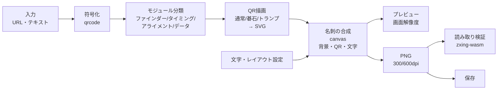

# QRcode-Converter 全体設計

最終更新: 2026-10-28（第2版：名刺レイアウト前提に変更）

URL（または任意テキスト）を、ドット部分を図案化したQRコードに変換し、
**名刺サイズ（91mm×55mm）の画像としてPNGで保存する**Webアプリ。自分用。

ドットの図案は、通常の四角・碁石（囲碁／オセロ）・トランプのスートに対応し、ロゴも埋め込める。
名刺の縦横、QRコードの位置、文字の配置とサイズを調整できる。

---

## 1. スコープ

| 機能 | 内容 | フェーズ |
|---|---|---|
| URL変換 | URL・テキストを入力し、即時にQRを生成 | 1 |
| ドット形状：通常 | ■（暗）／□（明） | 1 |
| ドット形状：碁石 | ●（黒石）／〇（白石 or 空き） | 1 |
| 背景色選択 | プリセット（碁盤・オセロ盤・白）＋自由色。碁石＋背景色で囲碁／オセロを表現 | 1 |
| 名刺レイアウト | 91×55mm。横配置／縦配置を選択。QRの位置（寄せ）とサイズを調整 | 1 |
| 文字の配置 | 文字を複数追加し、サイズ・書体・色・位置を調整 | 1 |
| 読み取り検証 | 保存するPNGそのものを実際にデコードし、読めるかを表示 | 1 |
| PNG保存 | 名刺サイズのPNG（300dpi／600dpi）。印刷時に91×55mmになるよう解像度情報を埋め込む | 1 |
| ドット形状：トランプ | ♣♥♦♠（暗）。明モジュールは白地のまま | 2 |
| ロゴ埋め込み | 画像をアップロードしてQRの中央に配置 | 3 |
| 仕上げ | 塗り足し、A4面付け、縦書き、設定の保存 など | 4 |

対象外（当面）：一般公開向けの機能（利用規約・OGP・アクセス解析）、短縮URLの発行、SVG・PDFでの書き出し。

---

## 2. 既存OSSの調査と採用方針

| OSS | ライセンス | 評価 | 採否 |
|---|---|---|---|
| [`qrcode`](https://www.npmjs.com/package/qrcode)（node-qrcode） | MIT | `QRCode.create()` でモジュール行列が取れる。UTF-8・日本語もそのまま扱える | **採用：符号化** |
| [`zxing-wasm`](https://www.npmjs.com/package/zxing-wasm) | MIT | ZXing-C++ のWASM版。ブラウザ・Node両方でQRを読める。読み取り専用ビルドは約0.9MB（gzip後約0.4MB） | **採用：読み取り検証** |
| [`@resvg/resvg-js`](https://www.npmjs.com/package/@resvg/resvg-js) | MPL-2.0 | SVG→PNGのラスタライズ。開発時のテスト専用（配布物には含めない） | **採用：テストのみ** |
| Noto Sans JP／Noto Serif JP | OFL | 日本語の書体。Google Fonts から読み込む | **採用：文字** |
| [`qr-code-styling`](https://www.npmjs.com/package/qr-code-styling) | MIT | ドット形状は固定プリセット（rounded／dots／classy 等）のみ。任意形状は描けない | 不採用（角の形・ロゴ処理の参考にする） |
| [`qrcode-generator`](https://www.npmjs.com/package/qrcode-generator) | MIT | `isDark()` で行列が取れるが、UTF-8は自前で変換が必要 | 不採用（`qrcode` で足りる） |
| [qrbtf](https://github.com/ciaochaos/qrbtf) | GPL-3.0 | パラメトリックなQR装飾の先行例 | **コードは流用しない**（GPLが本体に波及するため）。見た目の参考のみ |

**結論**：符号化と読み取りは既存OSSに任せ、描画（ドット形状・背景・ロゴ・名刺の合成）は自前の小さなレンダラーで書く。
トランプのスートのような任意形状は既存ライブラリの範囲外で、レンダラーを統一した方が保守が楽になるため。

本リポジトリのライセンスは MIT を想定（上記の依存ライブラリと整合する）。

---

## 3. 実現性検証（2026-10-28 実施）

Node上で「描画 → PNG化 → zxing-wasmでデコード」を自動で回し、見た目ごとに読めるかを確かめた。
PNG幅 600px／250px／200px＋ぼかし の3条件。


左から：囲碁（黒石のみ・角丸の角）、囲碁（白石あり・四角の角）、オセロ（明るい緑）、トランプ（初期案の白抜きスートあり。採用版は白地）

### 分かったこと

1. **三隅の位置検出パターン（ファインダー）を碁石やスートで描くと、全条件で読めなくなった。**
   ファインダーは常に「つながった形」で描く必要がある。四角・角丸・同心円の3種で試し、四角と角丸は安定、同心円はやや弱い。
2. **囲碁（木目色の背景）は非常に安定。** 黒石だけ置いて明モジュールを空き（盤の線だけ）にしても読めた。いちばん「碁盤らしい」見た目が使える。
3. **オセロは緑の明るさ次第。**
   - 濃い緑（#2E7D32）は、外枠を明るくしないと読めない。外枠があっても、誤り訂正Hでは縮小時に不安定。
   - 明るい緑（#66BB6A）なら、四角のファインダーで全条件OK。
   - → 背景色は自由に選べるようにしつつ、**明るさのガードと実デコード検証**を必須にする。
4. **トランプ（明モジュール白地）は、短いURL（26文字）・長いURL（94文字）× 誤り訂正M/Q/H の全条件OK**（ファインダーは四角）。赤（#B00020）も暗モジュールとして読まれた。
5. **ロゴ**：中央を幅の34%（面積の約11%）まで空けても、Q・Hとも読めた。安全側に、上限を幅30%、既定を22%とする。

---

## 4. アーキテクチャ

すべてブラウザ内で完結する静的サイト。入力したURLやロゴ画像はサーバーに送らない。



- **QRはSVGで描き、名刺はcanvasで合成する。** 文字（日本語フォント）をSVGに埋め込むと重く扱いにくいため、名刺全体はcanvasで組み立てる。
- **プレビューと保存は同じ合成関数を使う**（解像度だけ変える）。「画面と保存結果が違う」を防ぐ。
- **読み取り検証は、保存するPNGそのもの**に対して行う。文字がQRの余白に食い込んだ場合なども検出できる。
- 読み取り用のWASMは初回の検証時に遅延読み込みし、自前でホストする（CDNに依存しない）。

---

## 5. 名刺レイアウト

### 5.1 用紙と解像度

| 項目 | 値 |
|---|---|
| 仕上がりサイズ | 91×55mm（横配置）／55×91mm（縦配置） |
| 安全マージン | 端から3mm（文字やQRはこの内側に置く。外にはみ出すと警告） |
| 出力解像度 | 300dpi：1075×650px／600dpi：2150×1299px（縦配置は縦横を入れ替え） |
| 解像度情報 | PNGに `pHYs`（解像度）を書き込む。印刷ソフトで「実寸（100%）」を選べば91×55mmで出る |
| 塗り足し | フェーズ4で対応（印刷会社に出す場合の97×61mm） |

### 5.2 QRコードの配置

- QRは「盤」（コード部分＋周囲の余白4マス）を1つの正方形パネルとして扱う。サイズ指定はこのパネルの1辺（mm）。
- 寄せの指定は、名刺の長い辺の方向に3段階。

| 名刺の向き | 選択肢 | 既定 |
|---|---|---|
| 横配置（91×55） | 左寄せ／中央／右寄せ | 左寄せ |
| 縦配置（55×91） | 上寄せ／中央／下寄せ | 上寄せ |

  縦配置は横幅が55mmしかなく、左右に寄せる余地がほとんどないため、上下方向の寄せとして扱う。
- パネルの大きさ：20mm〜（短い辺−安全マージン×2）＝ 最大49mm。既定は横配置で40mm。
- 1マス（モジュール）の実寸を常に表示し、**0.5mm未満なら警告**する（スマホのカメラで読みにくくなる目安）。
  例：26文字のURL（25マス＋余白8マス＝33マス）を40mmにすると、1マス約1.2mm。

### 5.3 背景

- 名刺の背景色と、QRパネルの背景色を別々に選べる。
- 「盤を名刺全体に広げる」をオンにすると、名刺の背景をパネルと同じ色にする（碁盤の上に名前が書いてあるような見た目）。盤の線はパネル内だけに引く。

### 5.4 文字

- 文字のまとまり（テキストボックス）を複数追加できる。既定では「名前」「肩書き」「URL・連絡先」の3つを用意する。
- 1つのテキストボックスで設定できること：

| 項目 | 内容 |
|---|---|
| 文字 | 複数行可 |
| サイズ | pt指定（6〜36pt）。6pt未満は印刷で潰れやすいので不可 |
| 書体 | ゴシック（Noto Sans JP）／明朝（Noto Serif JP）、太さ（標準・太字） |
| 色 | 自由色 |
| 揃え | 左揃え／中央揃え／右揃え |
| 行間 | 1.0〜2.0 |
| 位置 | プレビュー上でドラッグ。mm単位の数値でも指定可。安全マージン・名刺の中心線・QRの端に吸着する |

- **自動配置**：QRを置いた残りの領域に、文字を上から順に並べる初期配置を用意する。そこから自由に動かせる。
- **重なりチェック**：文字がQRパネル（余白を含む）に重なったら警告する。余白が汚れると読めなくなるため。

---

## 6. データモデル

```ts
// 符号化結果
type ModuleKind = 'finder' | 'separator' | 'timing' | 'alignment' | 'format' | 'version' | 'data';

interface QrMatrix {
  size: number;                       // 1辺のモジュール数（21〜177）
  version: number;                    // 1〜40
  ecl: 'L' | 'M' | 'Q' | 'H';
  isDark(r: number, c: number): boolean;
  kind(r: number, c: number): ModuleKind;
}

// QRの見た目
interface QrStyleOptions {
  text: string;
  ecl: 'auto' | 'L' | 'M' | 'Q' | 'H';   // auto：ロゴありならH、なしならM
  style: 'square' | 'stone' | 'suits';
  background: { preset: 'go' | 'othello' | 'white' | 'custom'; color: string };
  finder: 'square' | 'rounded' | 'circle';
  stone?: { ratio: number; lightAs: 'empty' | 'white'; gridLines: boolean };
  suits?: { arrangement: 'random' | 'cycle' | 'single'; seed: number; single?: Suit };
  logo?: { dataUrl: string; widthRatio: number; padding: number; plate: boolean };
}

// 名刺
interface CardOptions {
  orientation: 'landscape' | 'portrait';
  background: string;                  // 名刺の背景色
  extendBoard: boolean;                // 盤を名刺全体に広げる
  qr: { align: 'start' | 'center' | 'end'; sizeMm: number; offsetMm: number };
  texts: TextBox[];
  export: { dpi: 300 | 600 };
}

interface TextBox {
  id: string;
  text: string;
  sizePt: number;
  font: 'sans' | 'serif';
  weight: 400 | 700;
  color: string;
  align: 'left' | 'center' | 'right';
  lineHeight: number;
  xMm: number; yMm: number;            // 名刺左上からの位置（揃えの基準点）
}
```

座標と寸法はすべて **mm** で持ち、描画時に解像度（px/mm）を掛ける。プレビューと保存で同じ値を使える。

### スタイルのプラグイン形式

スタイルを追加しやすいよう、1スタイル＝1ファイルにする。

```ts
interface StyleRenderer {
  id: string;
  /** 背景（盤面・線など）。モジュールより先に描く */
  background(ctx: DrawContext): string;
  /** データ等のモジュール1個分 */
  module(ctx: DrawContext, cell: CellInfo): string;
}
```

ファインダーは各スタイルから独立した共通部品（四角／角丸／円）で描く。
検証で、ここを崩すと読めなくなることが分かっているため。

---

## 7. スタイル仕様

### 7.1 通常（■□）
- 暗モジュール＝塗りの正方形、明モジュール＝描かない（背景）。
- 隣り合う正方形の間に細い隙間（ヘアライン）が出ないよう、わずかに重ねて描く。

### 7.2 碁石（●〇）— 囲碁／オセロ
- 暗モジュール＝黒石（半径はセルの0.44〜0.49倍、既定0.47）。
- 明モジュールの扱いを選べる。
  - **空き**：石を置かず、盤の線だけ見せる（囲碁らしい。既定）。
  - **白石**：白石を置く（オセロらしい）。
- 盤の線：セル中心を通る線（＝交点に石が乗る）。線は細く（セルの6%程度）、色は背景より暗い同系色。
- 背景プリセット

| プリセット | 背景色 | 線の色 | 明モジュール | ファインダー |
|---|---|---|---|---|
| 碁盤 | `#DCB35C` | `#5A4120` | 空き | 角丸 |
| オセロ盤 | `#66BB6A` | `#1B5E20` | 白石 | 四角 |
| 白 | `#FFFFFF` | なし | 空き | 角丸 |

- **背景色のガード**：黒石とのコントラストを計算し、背景が暗すぎる場合は警告する（オセロの濃い緑で読めなかった結果を踏まえる）。最終判断は実デコード検証に任せる。
- 装飾の「星（盤上の黒点）」は、明モジュールの中央に暗い点を置くことになり誤読の原因になるため、入れない。

### 7.3 トランプ（♣♥♦♠）
- 暗モジュール＝塗りのスート（♠♣は黒 `#111`、♥♦は赤 `#B00020`）。
- **明モジュールは何も描かない（白地のまま）。**
- スートの形はフォントではなくSVGパスで持つ（端末ごとに絵文字の見た目が変わるのを避ける）。
- 並べ方：ランダム（シード固定で再現可能）／4種を順に循環／1種だけ。
- 赤の明るさもガードの対象にする（明るい赤は明モジュール扱いされる恐れがある）。

---

## 8. ロゴ埋め込み

1. 画像（PNG/JPEG/SVG/WebP）をブラウザ内で読み込む。サーバーには送らない。
2. 誤り訂正を自動でHに上げる（手動指定時は警告）。
3. QRの中央の正方形領域（幅の既定22%、上限30%）のモジュールを描かずに、ロゴを置く。
   - ファインダー・タイミング・アライメントパターンにかかる場合は、領域を縮める。
   - 「下地プレート」（背景色の角丸四角）をオン・オフできる。
4. 隠したモジュール数を誤り訂正の能力と比べて、余裕を表示する（例：「訂正能力の45%を使用」）。

---

## 9. 読み取り検証

設定を変えるたびに（操作が落ち着いてから約300ms後に）自動で実行する。対象は保存されるPNGそのもの。

| 条件 | 内容 |
|---|---|
| 原寸 | 保存解像度（300dpi）の名刺画像全体でデコード |
| 縮小 | QR部分が1辺200px程度になるまで縮小してデコード（スマホで遠目に撮った想定） |
| ぼかし | 軽いぼかしを掛けてデコード（ピンぼけ想定） |

- 3条件すべてで元の入力と一致すれば「◎ 安定」、原寸のみOKなら「△ 注意」、原寸でもNGなら「× 読めません」と表示する。
- × のときは、原因の候補を出す（背景が暗い／ロゴが大きい／文字がQRに重なっている／1マスが小さすぎる など）。
- 注意：ZXingで読めても、すべてのスマホのカメラで読める保証にはならない。印刷後に実機で確認する。

---

## 10. UI

1画面構成。左に設定、右に名刺のプレビュー（実寸比）。設定は3つのタブに分ける。

```
┌──────────────────────────────┬──────────────────────────────┐
│ [QRコード] [名刺] [文字]          │  ┌─────────────────────┐    │
│                                 │  │ ┌───────┐  山田 太郎 │    │
│ ▼ QRコードタブ                    │  │ │ ● ●●  │  肩書き    │    │
│ URL [______________________]    │  │ │ ●● ● │          │    │
│ 図案  (通常)(碁石)(トランプ)        │  │ │ ● ●●  │  example. │    │
│ 背景  [碁盤][オセロ][白][色]        │  │ └───────┘  com      │    │
│ 白マス (空き)(白石)                │  └─────────────────────┘    │
│ 石の大きさ ───●──                 │                              │
│ 角の形 (四角)(角丸)(円)            │  ◎ 読み取り安定  1マス 1.2mm   │
│                                 │                              │
│ ▼ 名刺タブ：向き・QRの寄せ・サイズ・背景│  [PNGで保存]  (300dpi)(600dpi)│
│ ▼ 文字タブ：テキストボックスの追加・編集 │                              │
└──────────────────────────────┴──────────────────────────────┘
```

- プレビュー上で文字をドラッグして動かせる。選択中のテキストボックスは枠と安全マージンのガイドを表示する。
- 保存ファイル名は `meishi_YYYYMMDD_HHMM.png`。

---

## 11. 技術スタックとディレクトリ構成

- Vite ＋ TypeScript（UIフレームワークなし。状態は `QrStyleOptions` と `CardOptions` の2つ）
- テスト：Vitest
- ホスティング：Cloudflare（Workers の静的アセット配信）。自分用なので、必要ならCloudflare Accessで自分だけに制限できる

```
qrcode-converter/
├─ src/
│  ├─ core/
│  │  ├─ encode.ts        # qrcode → QrMatrix
│  │  └─ classify.ts      # モジュール種別の判定
│  ├─ styles/
│  │  ├─ square.ts
│  │  ├─ stone.ts
│  │  ├─ suits.ts
│  │  └─ finder.ts        # 共通のファインダー部品
│  ├─ qr/
│  │  └─ svg.ts           # QRパネルのSVG組み立て
│  ├─ card/
│  │  ├─ layout.ts        # mm座標の計算（QRの寄せ・自動配置・吸着・重なり判定）
│  │  ├─ compose.ts       # canvasで名刺を合成（プレビュー・保存共通）
│  │  ├─ text.ts          # フォント読み込み・複数行描画
│  │  └─ png.ts           # PNG書き出し＋解像度情報（pHYs）の埋め込み
│  ├─ verify/
│  │  └─ decode.ts        # zxing-wasm による検証（遅延読み込み）
│  ├─ ui/                 # タブ・フォーム・プレビュー・ドラッグ操作
│  └─ main.ts
├─ public/
│  └─ zxing_reader.wasm   # 自前ホスト
├─ tests/
│  ├─ readability.test.ts # スタイル×誤り訂正×文字列×解像度の総当たり検証
│  ├─ layout.test.ts      # 寄せ・自動配置・重なり判定
│  └─ png.test.ts         # pHYs が正しく入ること
├─ docs/
│  └─ DESIGN.md
├─ wrangler.jsonc
└─ package.json
```

---

## 12. テストとCI

- **可読性テスト（最重要）**：第3節の検証をそのままテスト化する。
  スタイル（通常／囲碁／オセロ／トランプ）× 誤り訂正（M／H）× 入力（短いURL、長いURL、日本語）× 解像度（600／250／200＋ぼかし）を総当たりし、既定設定はすべて「読める」ことを保証する。
  Node上では resvg でPNG化し、zxing-wasm でデコードする。
- レイアウトの単体テスト：寄せの位置計算、自動配置、安全マージンと重なりの判定。
- PNGの単体テスト：書き出したファイルの解像度情報が300／600dpiになっていること。
- GitHub Actions で push / PR ごとに実行。

---

## 13. 開発フェーズ

| フェーズ | 内容 | 完了条件 |
|---|---|---|
| 1 | QRの土台（符号化・分類・描画）、通常と碁石、背景プリセット、名刺レイアウト（縦横・寄せ・サイズ）、文字の追加と配置、読み取り検証、PNG保存（300／600dpi） | 既定設定が可読性テストを通り、印刷した名刺を実機（iPhone・Android の標準カメラ）で読める |
| 2 | トランプのスート（3種の並べ方） | 同上 |
| 3 | ロゴ埋め込み（領域計算・訂正能力の余裕表示） | 幅30%まで可読性テストを通る |
| 4 | 塗り足し（97×61mm）、A4用紙への面付け（自宅印刷用）、縦書き、設定の保存と読み込み | — |

---

## 14. 決定事項と未決事項

### 決定（2026-10-28）
- 用途は自分用。一般公開向けの機能は作らない。
- 出力はPNG。名刺サイズ（91×55mm）が前提。
- 名刺は横配置・縦配置を選べる。QRは寄せ（横：左／中央／右、縦：上／中央／下）を選べる。
- 文字はサイズを調整して配置できる。
- トランプの明モジュールは白地のまま（白抜きのスートは描かない）。

### 未決
1. **印刷方法**：自宅のプリンター（名刺用紙）か、印刷会社か。印刷会社なら塗り足しの優先度を上げ、自宅ならA4面付けの優先度を上げる。
2. 縦配置の寄せを「上下」と解釈した点が意図と合っているか。
