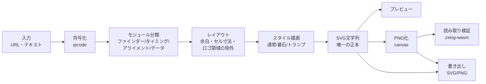

# QRcode-Converter 全体設計

最終更新: 2026-10-28

URL（または任意テキスト）を、ドット部分を図案化したQRコードに変換するWebアプリ。
碁石（囲碁・オセロ）、通常の四角、トランプのスート、ロゴ埋め込みに対応する。

---

## 1. スコープ

| 機能 | 内容 | フェーズ |
|---|---|---|
| URL変換 | URL・テキストを入力し、即時にQRを生成 | 1 |
| ドット形状：通常 | ■（暗）／□（明） | 1 |
| ドット形状：碁石 | ●（黒石）／〇（白石 or 空き） | 1 |
| 背景色選択 | プリセット（碁盤・オセロ盤・白）＋カスタム。碁石＋背景色で囲碁／オセロを表現 | 1 |
| 読み取り検証 | 生成した画像を実際にデコードし、読めるかを表示 | 1 |
| 書き出し | PNG（倍率指定）／SVG | 1 |
| ドット形状：トランプ | ♣♥♦♠（暗）／♧♡♢♤（明） | 2 |
| ロゴ埋め込み | 画像をアップロードして中央に配置 | 3 |
| 仕上げ | 設定の共有URL、印刷用高解像度、PWA など | 4 |

対象外（当面）：短縮URLの発行（サーバー側の保存が必要になるため）、AI生成アートQR。

---

## 2. 既存OSSの調査と採用方針

| OSS | ライセンス | 評価 | 採否 |
|---|---|---|---|
| [`qrcode`](https://www.npmjs.com/package/qrcode)（node-qrcode） | MIT | `QRCode.create()` でモジュール行列が取れる。UTF-8・日本語もそのまま扱える | **採用：符号化** |
| [`zxing-wasm`](https://www.npmjs.com/package/zxing-wasm) | MIT | ZXing-C++ のWASM版。ブラウザ・Node両方でQRを読める。読み取り専用ビルドは約0.9MB（gzip後約0.4MB） | **採用：読み取り検証** |
| [`@resvg/resvg-js`](https://www.npmjs.com/package/@resvg/resvg-js) | MPL-2.0 | SVG→PNGのラスタライズ。開発時のテスト専用（配布物には含めない） | **採用：テストのみ** |
| [`qr-code-styling`](https://www.npmjs.com/package/qr-code-styling) | MIT | ドット形状は固定プリセット（rounded／dots／classy 等）のみ。任意形状は描けない | 不採用（角の形・ロゴ処理の参考にする） |
| [`qrcode-generator`](https://www.npmjs.com/package/qrcode-generator) | MIT | `isDark()` で行列が取れるが、UTF-8は自前で変換が必要 | 不採用（`qrcode` で足りる） |
| [qrbtf](https://github.com/ciaochaos/qrbtf) | GPL-3.0 | パラメトリックなQR装飾の先行例 | **コードは流用しない**（GPLが本体に波及するため）。見た目の参考のみ |

**結論**：符号化と読み取りは既存OSSに任せ、描画（ドット形状・背景・ロゴ）は自前の小さなレンダラーで書く。
トランプのスートのような任意形状は既存ライブラリの範囲外で、レンダラーを統一した方が保守が楽になるため。

本リポジトリのライセンスは MIT を想定（上記の依存ライブラリと整合する）。

---

## 3. 実現性検証（2026-10-28 実施）

Node上で「描画 → PNG化 → zxing-wasmでデコード」を自動で回し、見た目ごとに読めるかを確かめた。
テキストは `https://note.com/tanaka936`、PNG幅 600px／250px／200px＋ぼかし の3条件。


左から：囲碁（黒石のみ・角丸の角）、囲碁（白石あり・四角の角）、オセロ（明るい緑）、トランプ（誤り訂正H）

### 分かったこと

1. **三隅の位置検出パターン（ファインダー）を碁石やスートで描くと、全条件で読めなくなった。**
   ファインダーは常に「つながった形」で描く必要がある。四角・角丸・同心円の3種で試し、四角と角丸は安定、同心円はやや弱い。
2. **囲碁（木目色の背景）は非常に安定。** 黒石だけ置いて明モジュールを空き（盤の線だけ）にしても読めた。いちばん「碁盤らしい」見た目が使える。
3. **オセロは緑の明るさ次第。**
   - 濃い緑（#2E7D32）は、外枠を明るくしないと読めない。外枠があっても、誤り訂正Hでは縮小時に不安定。
   - 明るい緑（#66BB6A）なら、四角のファインダーで全条件OK。
   - → 背景色は自由に選べるようにしつつ、**明るさのガードと実デコード検証**を必須にする。
4. **トランプのスートは、誤り訂正M・Hとも全条件OK**（ファインダーは四角）。赤（#B00020）も暗モジュールとして読まれた。
5. **ロゴ**：中央を幅の34%（面積の約11%）まで空けても、Q・Hとも読めた。安全側に、上限を幅30%、既定を22%とする。

---

## 4. アーキテクチャ

すべてブラウザ内で完結する静的サイト。入力したURLやロゴ画像はサーバーに送らない。



- **SVGを唯一の正本**にする。プレビュー・PNG・検証はすべて同じSVGから作るので、「画面では読めたのに書き出したら読めない」が起きにくい。
- 読み取り検証は重い（WASM約0.9MB）ので、初回の検証時に遅延読み込みする。`.wasm` は自前でホストし、CDNに依存しない。

---

## 5. データモデル

```ts
// 符号化結果
type ModuleKind = 'finder' | 'separator' | 'timing' | 'alignment' | 'format' | 'version' | 'data';

interface QrMatrix {
  size: number;                       // 1辺のモジュール数（21〜177）
  version: number;                    // 1〜40
  ecl: 'L' | 'M' | 'Q' | 'H';
  isDark(r: number, c: number): boolean;
  kind(r: number, c: number): ModuleKind;
}

// 描画の設定（UIの状態そのもの。共有URLにもこれをそのまま載せる）
interface RenderOptions {
  text: string;
  ecl: 'auto' | 'L' | 'M' | 'Q' | 'H';   // auto：ロゴありならH、なしならM
  style: 'square' | 'stone' | 'suits';
  background: { preset: 'go' | 'othello' | 'white' | 'custom'; color: string };
  finder: 'square' | 'rounded' | 'circle';
  quietZone: number;                      // 既定4モジュール
  stone?: { ratio: number; lightAs: 'empty' | 'white'; gridLines: boolean };
  suits?: { arrangement: 'random' | 'cycle' | 'single'; seed: number; single?: Suit };
  logo?: { dataUrl: string; widthRatio: number; padding: number; plate: boolean };
  export: { format: 'png' | 'svg'; scale: number };
}
```

### スタイルのプラグイン形式

スタイルを追加しやすいよう、1スタイル＝1ファイルにする。

```ts
interface StyleRenderer {
  id: string;
  /** 背景（盤面・線など）。モジュールより先に描く */
  background(ctx: DrawContext): string;
  /** データ等のモジュール1個分 */
  module(ctx: DrawContext, cell: CellInfo): string;
  /** 3隅のファインダー。可読性のため形の選択肢を限定する */
  finder(ctx: DrawContext, origin: { r: number; c: number }): string;
}
```

ファインダーは各スタイルから独立して、共通部品（四角／角丸／円）を使う。
検証で、ここを崩すと読めなくなることが分かっているため。

---

## 6. スタイル仕様

### 6.1 通常（■□）
- 暗モジュール＝塗りの正方形、明モジュール＝描かない（背景）。
- 隣り合う正方形の間に細い隙間（ヘアライン）が出ないよう、0.3%程度重ねて描く。

### 6.2 碁石（●〇）— 囲碁／オセロ
- 暗モジュール＝黒石（半径はセルの0.44〜0.49倍、既定0.47）。
- 明モジュールの扱いを選べる。
  - **空き**：石を置かず、盤の線だけ見せる（囲碁らしい。既定）。
  - **白石**：白石を置く（オセロらしい）。
- 盤の線：セル中心を通る線（＝交点に石が乗る）。線は細く（セルの6%程度）、色は背景より暗い同系色。
- 背景プリセット

| プリセット | 背景色 | 線の色 | 明モジュール | ファインダー |
|---|---|---|---|---|
| 碁盤 | `#DCB35C` | `#5A4120` | 空き | 角丸 |
| オセロ盤 | `#66BB6A` | `#1B5E20` | 白石 | 四角 |
| 白 | `#FFFFFF` | なし | 空き | 角丸 |

- **背景色のガード**：黒石とのコントラストを計算し、背景が暗すぎる場合は警告する（オセロの濃い緑で読めなかった結果を踏まえる）。最終判断は実デコード検証に任せる。
- 周囲の余白（クワイエットゾーン）は、背景が暗めのときは明るい外枠色で描く（盤の縁に見えるように）。
- 装飾の「星（盤上の黒点）」は、明モジュールの中央に暗い点を置くことになり誤読の原因になるため、初期版では入れない。

### 6.3 トランプ（♣♥♦♠ / ♧♡♢♤）
- 暗モジュール＝塗りのスート（♠♣は黒 `#111`、♥♦は赤 `#B00020`）。
- 明モジュール＝白抜きのスート（輪郭だけ・薄い色）。中央が明るいので明モジュールとして読まれる。
- スートの形はフォントではなくSVGパスで持つ（端末ごとに絵文字の見た目が変わるのを避ける）。
- 並べ方：ランダム（シード固定で再現可能）／4種を順に循環／1種だけ。
- 赤の暗さはガードの対象にする（明るい赤は明モジュール扱いされる恐れがある）。

---

## 7. ロゴ埋め込み

1. 画像（PNG/JPEG/SVG/WebP）をブラウザ内で読み込み、data URL化する。サーバーには送らない。
2. 誤り訂正を自動でHに上げる（手動指定時は警告）。
3. 中央の正方形領域（幅の既定22%、上限30%）のモジュールを描かずに、ロゴを置く。
   - ファインダー・タイミング・アライメントパターンにかかる場合は、領域を縮める。
   - 「下地プレート」（背景色の角丸四角）をオン・オフできる。
4. 隠したモジュール数を誤り訂正の能力と比べて、余裕を表示する（例：「訂正能力の45%を使用」）。

---

## 8. 読み取り検証

生成のたびに（入力が落ち着いてから約300ms後に）自動で実行する。

| 条件 | 内容 |
|---|---|
| 原寸 | 書き出しと同じ解像度でデコード |
| 縮小 | 1辺200px程度に縮小してデコード（スマホで遠目に撮った想定） |
| ぼかし | 軽いぼかしを掛けてデコード（ピンぼけ想定） |

- 3条件すべてで、元の入力と一致すれば「◎ 安定」、原寸のみOKなら「△ 注意」、原寸でもNGなら「× 読めません」と表示する。
- × のときは、原因の候補を出す（背景が暗い／ロゴが大きい／石が小さい など）。
- 注意：ZXingで読めても、すべてのスマホのカメラアプリで読める保証にはならない。実機確認を促す一文を添える。

---

## 9. UI

1画面構成。左に設定、右にプレビュー（スマホでは縦に並べる）。

```
┌───────────────────────────┬─────────────────────┐
│ URL・テキスト [______________] │                     │
│ スタイル  (通常)(碁石)(トランプ) │     プレビュー        │
│ 背景      [碁盤][オセロ][白][色] │                     │
│ 明モジュール (空き)(白石)       │                     │
│ 石の大きさ ───●──             │  ◎ 読み取り安定        │
│ 角の形    (四角)(角丸)(円)      │  バージョン3 / 29×29  │
│ ロゴ      [画像を選ぶ] 幅 ─●─   │                     │
│ 誤り訂正  (自動)(L)(M)(Q)(H)   │ [PNGで保存][SVGで保存] │
└───────────────────────────┴─────────────────────┘
```

- URLが長いほどモジュールが増えて石が小さくなるので、モジュール数を常に表示する。

---

## 10. 技術スタックとディレクトリ構成

- Vite ＋ TypeScript（UIフレームワークなし。状態は `RenderOptions` 1つ）
- テスト：Vitest
- ホスティング：Cloudflare（Workers の静的アセット配信）

```
qrcode-converter/
├─ src/
│  ├─ core/
│  │  ├─ encode.ts        # qrcode → QrMatrix
│  │  ├─ classify.ts      # モジュール種別の判定
│  │  └─ layout.ts        # 余白・セル寸法・ロゴ領域
│  ├─ styles/
│  │  ├─ square.ts
│  │  ├─ stone.ts
│  │  ├─ suits.ts
│  │  └─ finder.ts        # 共通のファインダー部品
│  ├─ render/
│  │  ├─ svg.ts           # SVG組み立て（正本）
│  │  └─ raster.ts        # SVG → PNG（canvas）
│  ├─ verify/
│  │  └─ decode.ts        # zxing-wasm による検証（遅延読み込み）
│  ├─ ui/                 # フォーム・プレビュー・書き出し
│  └─ main.ts
├─ public/
│  └─ zxing_reader.wasm   # 自前ホスト
├─ tests/
│  ├─ readability.test.ts # スタイル×誤り訂正×文字列×解像度の総当たり検証
│  └─ fixtures/
├─ docs/
│  └─ DESIGN.md
├─ wrangler.jsonc
└─ package.json
```

---

## 11. テストとCI

- **可読性テスト（最重要）**：第3節の検証をそのままテスト化する。
  スタイル（通常／囲碁／オセロ／トランプ）× 誤り訂正（M／H）× 入力（短いURL、長いURL、日本語）× 解像度（600／250／200＋ぼかし）を総当たりし、既定設定はすべて「読める」ことを保証する。
  Node上では resvg でPNG化し、zxing-wasm でデコードする。
- 単体テスト：モジュール分類、ロゴ領域の計算、コントラスト計算。
- GitHub Actions で push / PR ごとに実行。

---

## 12. 開発フェーズ

| フェーズ | 内容 | 完了条件 |
|---|---|---|
| 1 | 土台（符号化・分類・SVG描画）、通常と碁石、背景プリセット（碁盤／オセロ盤／白／カスタム）、読み取り検証、PNG/SVG書き出し、Cloudflareへのデプロイ | 既定設定がすべて可読性テストを通り、実機（iPhone・Android の標準カメラ）で読める |
| 2 | トランプのスート（3種の並べ方） | 同上 |
| 3 | ロゴ埋め込み（領域計算・訂正能力の余裕表示） | 幅30%まで可読性テストを通る |
| 4 | 設定の共有URL、印刷用高解像度、PWA、ほかの図案の追加 | — |

---

## 13. 未決事項

1. **公開範囲**：自分用か、一般公開するか（公開ならOGP・利用規約・アクセス解析の要否を決める）。
2. **トランプの明モジュール**：白抜きのスート（♧♡♢♤）を描く想定でよいか。描かない（白地のまま）案もある。
3. **独自ドメイン**を使うか。
